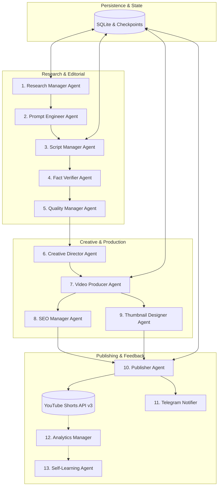

# 🎬 AI-Powered YouTube Shorts Automation Platform

[](https://github.com/agrilearningpoint/yt-daily-shorts/actions/workflows/tests.yml)
[](https://github.com/agrilearningpoint/yt-daily-shorts/actions/workflows/daily_shorts.yml)
[](https://www.python.org/)
[](LICENSE)
[](#zero-budget-architecture)

A cloud-native, autonomous, multi-agent platform designed to research, script, produce, voice, edit, optimize, and publish **2 high-impact YouTube Shorts daily in natural Hindi** (with a configurable third video), executed on **GitHub Actions** with **100% free-tier services**.

---

## 📌 Primary Objective & Video Schedule

The platform automatically produces and publishes two distinct 50–60 second vertical shorts (1080x1920) daily:

1. **Video A: Morning News Short (05:30 AM IST / 00:00 UTC)**
   - Researches top national, international, technology, science, economic, and policy news from the last 24 hours.
   - Sourced from official feeds: PIB, DD News, ISRO, and verified publishers.
   - Preserves all original source URLs in the YouTube description.
   - Fast-paced 3–5 second hook with dynamic transitions and Hindi voiceover.

2. **Video B: Daily Knowledge / Explainer Short (02:30 PM IST / 09:00 UTC)**
   - Dynamic deep-dives following a structured **7-Day Editorial Calendar**:
     | Day | Category | Topics & Examples |
     | :--- | :--- | :--- |
     | **Monday** | Indian Politics & Leaders | Dr. B.R. Ambedkar, Constitution of India, Sardar Patel |
     | **Tuesday** | Science & Technology | Chandrayaan-3, Aditya-L1, UPI Digital Infrastructure |
     | **Wednesday** | Medical Science & Health | Ayurveda scientific validation, Ronald Ross malaria discovery |
     | **Thursday** | Great Personalities | Mahatma Gandhi, Bhagat Singh, Birsa Munda, Dr. APJ Abdul Kalam |
     | **Friday** | History, Temples & Heritage | Kailasa Temple Ellora, Konark Sun Temple, Nalanda University |
     | **Saturday** | Inventions & Discoveries | Invention of Zero (Aryabhata), Raman Effect (C.V. Raman) |
     | **Sunday** | Economy, Society & World | Green Revolution, Amul White Revolution, 5-Trillion Economy |

3. **Video C: Optional Third Short (Configurable)**
   - Enabled when `daily_video_count: 3` in `config/settings.yaml`.

---

## 🏛️ Multi-Agent Architecture

The system operates as an assembly line of 12 decoupled, resilient Python agents coordinated by `DailyOrchestrator` with SQLite checkpointing:



### Agent Responsibilities:
* **Research Manager (`RM`)**: Aggregates multi-source RSS/APIs, filters past 24h, computes Jaccard deduplication.
* **Prompt Engineer (`PE`)**: Synthesizes trending curiosity hooks and compiles Jinja2 prompt templates.
* **Script Manager (`SM`)**: LLM-driven structured Hindi script writer with strict word pacing (~2.5 words/sec).
* **Fact Verifier (`FV`)**: Cross-checks facts, dates, and statistics against trusted sources to eliminate hallucinations.
* **Quality Manager (`QM`)**: Validates hook strength, Hindi grammar, duration bounds (45–60s), and scene pacing.
* **Creative Director (`CD`)**: Rotates themes, typography, background gradients, and audio moods.
* **Video Producer (`VP`)**: Generates Hindi neural voiceover (`edge-tts`), gathers imagery, compiles vertical subtitles (`SRT`), and renders 1080x1920 MP4 via `FFmpeg`.
* **SEO Manager (`SEO`)**: Writes high-CTR titles under 100 characters, tags, and numbered source links in description.
* **Thumbnail Designer (`TD`)**: Generates bold, contrasting mobile cover art with Hindi typography.
* **Publisher (`PUB`)**: Secure OAuth2 uploader for YouTube Data API v3 with automatic `DRY_RUN` safety.
* **Analytics Manager (`AM`)**: Tracks views, likes, and retention metrics.
* **Self-Learning Agent (`SL`)**: Studies performance patterns to enhance future prompts and theme selection.

---

## 🔒 Security & GitHub Secrets Configuration

> [!IMPORTANT]
> **Zero Secrets in Code**: All API tokens, OAuth keys, and passwords must be stored exclusively in **GitHub Actions Secrets** (`Settings -> Secrets and variables -> Actions`). Never commit `.env` or credential JSON files.

### Required & Optional GitHub Secrets:

| Secret Name | Required? | Purpose & Service |
| :--- | :---: | :--- |
| `GEMINI_API_KEY` | **Recommended** | Primary free LLM via [Google AI Studio](https://aistudio.google.com/) |
| `GROQ_API_KEY` | Optional | Fallback fast LLM via [Groq Cloud](https://console.groq.com/) |
| `TELEGRAM_BOT_TOKEN` | Optional | Telegram Bot API token from [@BotFather](https://t.me/botfather) |
| `TELEGRAM_CHAT_ID` | Optional | Your Telegram User ID or Channel ID for status alerts |
| `YOUTUBE_CLIENT_SECRET_JSON` | Optional* | Google OAuth Client Secret JSON string (*needed for live upload) |
| `YOUTUBE_TOKEN_JSON` | Optional* | Google OAuth Refresh Token JSON string (*needed for live upload) |
| `PEXELS_API_KEY` | Optional | Free stock video/photo API from [Pexels](https://www.pexels.com/api/) |
| `PIXABAY_API_KEY` | Optional | Free stock video/photo API from [Pixabay](https://pixabay.com/api/docs/) |
| `HF_TOKEN` | Optional | Free Hugging Face token for generative AI images |
| `MONGODB_URI` | Optional | Remote MongoDB Atlas URI (SQLite is used by default) |
| `CLOUDFLARE_R2_ACCESS_KEY` | Optional | S3-compatible cloud storage for raw video artifacts |
| `CLOUDFLARE_R2_SECRET_KEY` | Optional | Cloudflare R2 Secret Key |

* *When YouTube credentials are not supplied or `dry_run: true`, the system executes completely in **DRY_RUN mode**, producing valid videos locally and creating full simulation reports without consuming API quotas.*

---

## 🚀 Quick Start & Local Development

### 1. Clone & Set Up Virtual Environment
```bash
git clone https://github.com/agrilearningpoint/yt-daily-shorts.git
cd yt-daily-shorts
python -m venv venv
# On Windows:
.\venv\Scripts\activate
# On Linux/macOS:
source venv/bin/activate
pip install -r requirements.txt
```

### 2. Configure Local Settings (Optional)
Copy `.env.example` to `.env` and fill in your keys:
```bash
cp .env.example .env
```

### 3. Run Pipeline in Local Dry-Run Mode
```bash
python main.py --video-type all --dry-run
```

Outputs will be rendered under `output/<video_id>/final_short.mp4` along with voiceover audio, subtitles, and thumbnails.

### 4. Check Pipeline State
```bash
python main.py --status
```

### 5. Resume a Failed Pipeline
```bash
python main.py --resume <video_id>
```

---

## 🧪 Automated Testing

The repository includes a comprehensive unit and integration test suite:

```bash
python -m pytest tests/ -v
```

All pipeline stages are covered by automated tests:
* Configuration & Editorial Calendar validation
* SQLite state management & checkpoint serialization
* News collection, 24h date filtering, and Jaccard deduplication
* Hindi TTS synthesis and SRT subtitle generator
* Procedural 1080x1920 graphic card rendering
* SEO title and numbered source description formatting
* End-to-end multi-agent dry-run execution

---

## ☁️ GitHub Actions Cloud Automation

Production execution runs entirely on GitHub's cloud infrastructure:

* **Automated Schedule**: Triggered at 00:00 UTC (5:30 AM IST) and 09:00 UTC (2:30 PM IST).
* **Manual Dispatch**: Go to `Actions` -> `Daily YouTube Shorts Production` -> `Run workflow` with options to choose video type and Dry-Run mode.
* **Artifacts Retention**: Rendered MP4 videos, logs, and SQLite database are automatically saved as job artifacts for 7 days.
* **Instant Alerts**: Critical failures send immediate Telegram notifications with direct links to the failing GitHub Action run.

---

## 📜 License & Compliance

Distributed under the **MIT License**. See [LICENSE](LICENSE) for details.

* **Factual Integrity First**: All news and historical claims cite verified sources (PIB, DD News, ISRO, Wikipedia).
* **Copyright Compliance**: Visuals utilize licensed stock media (Pexels, Pixabay), public domain resources, or procedurally generated vector cards.
