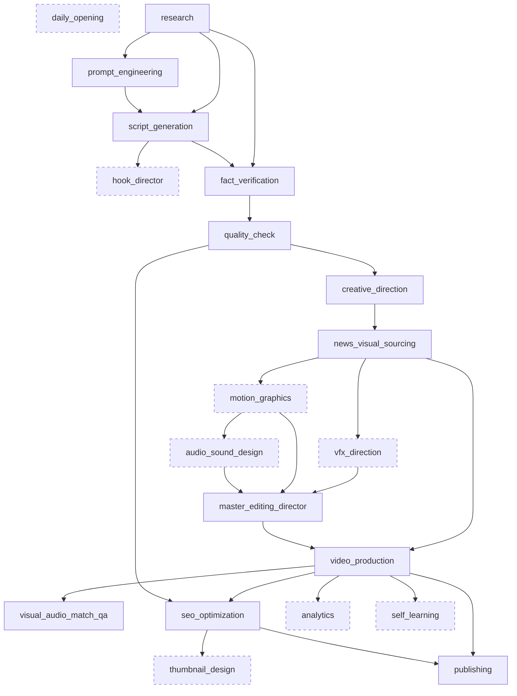

# Agent Wiring Matrix

**Generated from `core/agent_registry.py` — do not edit by hand.**
Regenerate with: `python scripts/gen_agent_docs.py`

Every stage declares what it requires, what it publishes and whether a run may continue without
it. The orchestrator runs this registry's audit on every episode, before publishing and again
after: a critical stage that did not run, a stage that ran but published nothing, or a promised
key that went missing is a **failed run**, not a warning.

| # | stage | agent | critical | requires | provides |
|---|-------|-------|----------|----------|----------|
| 1 | `daily_opening` | DailyOpeningDirectorAgent | no | — | opening_brief |
| 2 | `research` | ResearchManagerAgent | yes | — | items, daily, sources |
| 3 | `prompt_engineering` | PromptEngineerAgent | yes | research | prompt_engineering, min_words, max_words, targets |
| 4 | `script_generation` | ScriptManagerAgent | yes | prompt_engineering, research | script |
| 5 | `hook_director` | HookDirectorAgent | no | script_generation | hook |
| 6 | `fact_verification` | FactVerifierAgent | yes | script_generation, research | verdict, script |
| 7 | `quality_check` | QualityManagerAgent | yes | fact_verification | score, script |
| 8 | `creative_direction` | CreativeDirectorAgent | yes | quality_check | creative_brief |
| 9 | `news_visual_sourcing` | NewsVisualSourcingAgent | yes | creative_direction | visual_plan, assets |
| 10 | `vfx_direction` | VFXAgent | no | news_visual_sourcing | vfx_plan |
| 11 | `motion_graphics` | MotionGraphicsAgent | no | news_visual_sourcing | motion_data |
| 12 | `audio_sound_design` | AudioSoundDesignAgent | no | motion_graphics | audio_plan, music, sfx |
| 13 | `master_editing_director` | MasterEditingDirectorAgent | yes | audio_sound_design, motion_graphics, vfx_direction | timeline |
| 14 | `video_production` | VideoProducerAgent | yes | master_editing_director, news_visual_sourcing | video_path, captions_srt, duration |
| 15 | `visual_audio_match_qa` | VisualAudioMatchQAAgent | yes | video_production | visual_match_score, qa_report |
| 16 | `seo_optimization` | SEOManagerAgent | yes | quality_check, video_production | title, description, tags |
| 17 | `thumbnail_design` | ThumbnailDesignerAgent | no | seo_optimization | thumbnail_path |
| 18 | `publishing` | PublisherAgent | yes | seo_optimization, video_production | youtube_id, youtube_url |
| 19 | `analytics` | AnalyticsManagerAgent | no | video_production | metrics |
| 20 | `self_learning` | SelfLearningAgent | no | video_production | learning_notes |

## Dependency graph

## Stage contract rules

| rule | meaning |
|------|---------|
| `requires` | the upstream stage whose payload this stage reads (not just the previous line in the file) |
| `provides` | the keys consumers may rely on |
| `must_provide` | a missing key here is a wiring break |
| `critical` | `yes` → absence fails the run; `no` → recorded as skipped and reported |

## Why this exists

A production run was found that rendered a video with no sourced visuals, no motion plan and no
master timeline, while the log looked healthy: five stages were marked `require_success=False` and
the orchestrator swallowed their failures without a word. The registry turns the pipeline into
data, so "did every agent actually run and hand its output to the next one?" is answered by the
code on every run instead of by a human reading a log.
