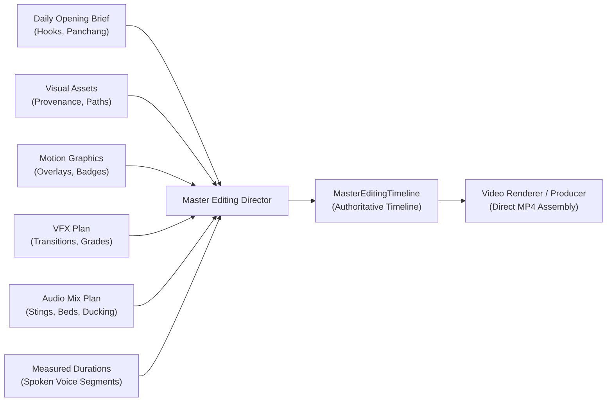

# Master Editing Director Agent — Technical Documentation

## 1. Overview & Architectural Role

`MasterEditingDirectorAgent` is the authoritative editing coordinator for **BHARAT KI SOCH**.

Historically, video rendering logic suffered from split creative authority:
- `CreativeDirectorAgent` chose aesthetic tone.
- `VFXAgent` chose transitions and camera motions.
- `MotionGraphicsAgent` generated broadcast lower-thirds and chyrons.
- However, internal logic inside `VideoProducerAgent` (specifically `EditorDirector.plan()`) would override these decisions and regenerate independent overlays and random color grades.

`MasterEditingDirectorAgent` completely resolves this conflict by acting as the **single source of truth** before rendering occurs. It synthesizes all upstream creative and technical decisions into a single immutable `MasterEditingTimeline`.

Location: `agents/master_editing_director/agent.py`  
Contracts: `MasterEditingTimeline`, `TimelineSegmentContract` in `core/agent_contracts.py`  
Unit Tests: `tests/test_agents/test_master_editing_director.py`

---

## 2. Input Synthesis & Decision Binding

The agent ingests and binds:

1. **Daily Opening Brief**: Binds opening hook candidate, Panchang summary, and visual opening beats.
2. **Visual Assets**: Ingests real photos or video clips with verified provenance and licenses. Marks `is_video_asset = True` for MP4/MOV assets.
3. **Motion Graphics**: Binds transparent PNG overlays (`overlay_hook.png`, `overlay_scene_001.png`, etc.) directly to corresponding segments.
4. **VFX Direction**: Assigns content-aware color grading (`broadcast_crisp`, `vivid_news`, etc.) and transition effects (`punch`, `flash`, `whip`, `luma`).
5. **Audio Mix Plan**: Binds the multi-track audio mix with sidechain ducking and broadcast loudness normalization (-14.0 LUFS).
6. **Frame Quantization**: Runs `SynchronizationEngine` to snap all segment durations to exact 30 FPS frame boundaries, preventing cumulative audio-video drift.

---

## 3. Translation to Renderer (`build_renderer_clips`)

The agent provides a direct method `build_renderer_clips(timeline, work_dir)` which converts `MasterEditingTimeline` segments into `SceneClip` objects for `VideoRenderer`:

- For video assets: sets `video=asset_path` and `depth=False`.
- For real photos: enables 3D depth motion (`depth=True`) and applies the assigned Ken Burns motion.
- For overlays: ensures overlay exists or creates a transparent frame.
- Guarantees 100% adherence to the timeline without duplicate generation.
