# BHARAT KI SOCH — AI Newsroom Production Architecture (Phase 2)

## 1. Executive Summary

This document establishes the production architecture of **BHARAT KI SOCH**, transforming the automated YouTube pipeline into an AI-driven Hindi Broadcast Newsroom and Long-Video Repurposing Studio.

The architecture operates in two coordinated modes:
- **Mode 1: Daily Broadcast Newsroom & Knowledge Studio**: Generates daily morning bulletins and deeply researched knowledge shorts with consistent female Hindi anchor voice (`hi-IN-SwaraNeural`), authentic Panchang / calendar openings, verified fact-checking, dynamic broadcast graphics, and multi-track audio sound design.
- **Mode 2: Long-Video-to-Shorts Repurposing Engine**: Intakes long news bulletins, speeches, and interviews; performs chunked transcription, speaker diarization, scene understanding, story extraction, external evidence verification, opportunistic viral ranking, moment selection snapped to speech pauses, rights attribution, and vertical re-framing (16:9 to 9:16).

---

## 2. High-Level System Architecture

```mermaid
flowchart TD
    subgraph Mode1["Mode 1: Daily Newsroom Bulletin"]
        DOD["Daily Opening Director\n(Panchang, Date, Observance)"] --> RM["Research Manager\n(National & Global Feeds)"]
        RM --> PE["Prompt Engineer"]
        PE --> SM["Script Manager\n(Hindi News Script)"]
        SM --> HD["Hook Director\n(Viral Archetypes & Visual Pairing)"]
        HD --> FV["Fact Verifier\n(Numerical & Source Audit)"]
        FV --> QM["Quality Manager\n(Pre-Production Gate)"]
    end

    subgraph Mode2["Mode 2: Long Video Intelligence"]
        LVI["Long Video Intake\n(Streaming SHA-256)"] --> TD["Transcription & Diarization\n(Chunked Hindi Speech)"]
        TD --> SU["Scene Understanding\n(Visual Bounds)"]
        SU --> SE["Story Extraction\n(Sliding Window Chunking)"]
        SE --> CE["Context Evidence Research\n(Fact Verification)"]
        CE --> SOR["Shorts Opportunity Ranker\n(Viral Scoring & Viability)"]
        SOR --> CMS["Clip Moment Selector\n(Speech Pause Snapping)"]
        CMS --> SA["Shorts Adaptation\n(Hindi Shorts Script)"]
        SA --> RA["Rights & Attribution\n(Fair Use & Provenance)"]
    end

    subgraph MasterProduction["Master Production & Sound Stage"]
        CD["Creative Director\n(Tone & Brand Visual Style)"]
        NVS["News Visual Sourcing\n(Publisher, Wikimedia, Brand Cards)"]
        MG["Motion Graphics Agent\n(56 Motion Presets, Chyrons, Badges)"]
        VFX["VFX Agent\n(Color Grading, Camera Moves, Transitions)"]
        ASD["Audio Sound Design\n(Intro Sting, Transitions, Ducked Bed)"]
        MED["Master Editing Director\n(Authoritative MasterEditingTimeline)"]
        VP["Video Producer / Renderer\n(FFmpeg Vertical 1080x1920 30FPS)"]
        VAM["Visual Audio Match QA\n(Pre & Post-Render Inspection)"]
    end

    subgraph Distribution["Distribution & Learning"]
        SEO["SEO Manager\n(Titles, Description, Tags)"]
        THUMB["Thumbnail Designer\n(High-CTR Visuals)"]
        PUB["Publisher Agent\n(YouTube OAuth / HF Dataset)"]
        NOTIF["Telegram Notifier\n(Editorial Reporting)"]
        SL["Self-Learning Agent\n(Audience Retention Feedback)"]
    end

    QM --> CD
    RA --> CD
    CD --> NVS
    NVS --> MG
    MG --> VFX
    VFX --> ASD
    ASD --> MED
    MED --> VP
    VP --> VAM
    VAM --> SEO
    SEO --> THUMB
    THUMB --> PUB
    PUB --> NOTIF
    NOTIF --> SL
```

---

## 3. Core Component Capabilities

### 3.1 Mode 1: Daily Opening & Newsroom Intelligence
- **Daily Opening Director**: Computes Hindu Panchang (Tithi, Paksha, Masa), verified National and UN Observances, and historical anniversaries ("On This Day") with evidence sources. Generates 5 distinct opening hook candidates and pairs them with motion presets.
- **Multi-Source News Ingestion**: Ingests domestic and international news across verified feeds without hallucination or unsourced claims.
- **Female Hindi Anchor Voice**: Primary voice switched to `hi-IN-SwaraNeural` (clear, authoritative broadcast cadence) with `hi-IN-MadhurNeural` as fallback.

### 3.2 Master Editing Director & Single Source of Truth
- Eliminates duplicate creative decisions by binding all visual assets, overlays, motion presets, VFX transitions, and audio cues into a single immutable `MasterEditingTimeline`.
- Frame-quantized duration synchronization: guarantees integer frame boundaries at 30 FPS, preventing audio-visual drift.

### 3.3 Broadcast Sound Design & Multi-Track Mixing
- Schedules CC0/Original broadcast audio cues:
  - News Intro Sting (`sting_news_intro.wav`)
  - Topic Transition Whoosh (`transition_whoosh.wav`)
  - Bulletin Impact (`impact_bulletin.wav`)
  - Outro Closing Sting (`ending_sting.wav`)
- Multi-track FFmpeg audio mixing with sidechain ducking: ambient news bed drops to -24 dB during voice narration and restores cleanly during pauses.

### 3.4 56 Motion Presets Library
- 7 modular categories (8 presets each = 56 presets) in `video/motion_presets/`:
  1. Openers
  2. Headline Reveals
  3. Photo Motion
  4. Video Reframe
  5. Data Graphics
  6. Transitions
  7. Brand & Outros

### 3.5 Automated Pre & Post-Render Quality Assurance
- `VisualAudioMatchQAAgent` inspects file existence, font availability, semantic relevance, audio-video duration match, and stream properties (1080x1920, 30 FPS, 15s–59s duration).
