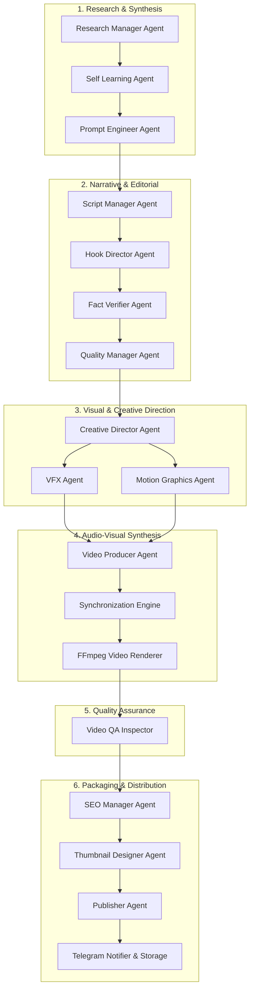

# Multi-Agent Production Architecture

## Overview
This document specifies the modernized, strongly-typed multi-agent architecture for **BHARAT KI SOCH** YouTube Shorts automation. The system coordinates 17 specialized AI and engineering agents through a centralized production context (`ProductionContext`) with strict typed dataclass contracts (`core/agent_contracts.py`), dependency-aware checkpoint invalidation, and independent quality gates.

---

## 1. Pipeline Execution Flow



---

## 2. Agent Inventory & Responsibility Matrix

| Agent Name | Module Path | Input Contract | Output Contract | Downstream Consumers |
| :--- | :--- | :--- | :--- | :--- |
| **Research Manager** | `agents/research_manager/` | `VideoTask` (type, category) | `ResearchContext` | Prompt Engineer, Fact Verifier |
| **Prompt Engineer** | `agents/prompt_engineer/` | `ResearchContext`, `word_bounds` | Prompt string & word targets | Script Manager |
| **Script Manager** | `agents/script_manager/` | Prompt, word bounds, targets | `ApprovedScript` | Hook Director, Fact Verifier |
| **Hook Director** | `agents/hook_director/` | Lead story, script, 6 archetypes | `ApprovedHook` (scored >= 75) | Fact Verifier, Video Producer |
| **Fact Verifier** | `agents/fact_verifier/` | `ApprovedScript`, `ResearchContext` | `FactVerificationReport` | Quality Manager |
| **Quality Manager** | `agents/quality_manager/` | Script, verification report | Script Quality Score (>= 80) | Creative Director |
| **Creative Director** | `agents/creative_director/` | Script, channel identity | `CreativeBrief` | VFX Agent, Motion Graphics, Producer |
| **VFX Agent** | `agents/vfx_agent/` | Script, CreativeBrief | `List[VFXPlanItem]` | Video Producer, Editor Director |
| **Motion Graphics** | `agents/motion_graphics/` | Script, ApprovedHook, channel | `List[MotionGraphicsPlanItem]` | Video Producer |
| **Video Producer** | `agents/video_producer/` | Script, Hook, VFX, Motion, Brief | Rendered video & media credits | QA Inspector, SEO, Publisher |
| **Video QA Inspector** | `video/qa_inspector.py` | MP4 video file path | `QualityVerificationVerdict` | Orchestrator (Gate / Auto-repair) |
| **SEO Manager** | `agents/seo_manager/` | ApprovedScript, video metadata | YouTube metadata (Title, Desc, Tags) | Publisher |
| **Thumbnail Designer** | `agents/thumbnail_designer/` | Script, visuals, hook | 1080x1920 cover JPEG | Publisher, Telegram |
| **Publisher** | `agents/publisher/` | Video MP4, Thumbnail, SEO | YouTube ID & URL | State Manager, Telegram Notifier |

---

## 3. Production Context & Dependency Invalidation

To prevent stale cache bugs where upstream script revisions mismatch downstream rendered audio and video, `core/production_context.py` defines a centralized `STAGE_DEPENDENCY_GRAPH`.

When an upstream stage is re-run (e.g. script correction after fact verification), `StateManager.invalidate_downstream(video_id, stage_name)` automatically purges cached checkpoint rows for all dependent stages:
- Modifying `script_generation` invalidates `fact_verification`, `quality_check`, `creative_direction`, `vfx_direction`, `motion_graphics`, `video_production`, `seo_optimization`, `thumbnail_design`, and `publishing`.
- Modifying `creative_direction` invalidates `vfx_direction`, `motion_graphics`, and `video_production`.

---

## 4. Hook Director: 6 Viral Archetypes & Visual Contract

The `HookDirectorAgent` crafts opening hooks evaluated against 6 viral archetypes:
1. `curiosity_gap`: Opens a knowledge gap that demands watching to resolve.
2. `unexpected_fact`: Starts with a startling, counter-intuitive verified statistic.
3. `strong_factual_statement`: Bold, authoritative statement anchored in the lead event.
4. `direct_impact`: Explains how the story impacts the viewer's wallet, family, or life.
5. `breaking_news`: Urgent bulletin delivery highlighting immediate national impact.
6. `emotional_intrigue`: Evokes curiosity, awe, or urgent wonder.

### Strict Visual Contract (Opening 1–3 Seconds)
The Hook Director pairs the chosen hook with a concrete visual entity:
```json
{
  "text": "पीएम मोदी ने 12 हज़ार करोड़ की परियोजनाओं का किया ऐलान!",
  "archetype": "breaking_news",
  "paired_visual_entity": "Narendra Modi",
  "paired_visual_path": "https://upload.wikimedia.org/...",
  "headline_overlay": "पीएम मोदी ने 12 हज़ार करोड़ की परियोजनाओं का किया ऐलान!",
  "quality_score": 88.5
}
```
The Video Producer binds this entity directly to the opening 0–3 second beat, eliminating opening audio-visual mismatch.

---

## 5. Unified Duration Policy

All components enforce the YouTube Shorts duration contract:
- **Target Duration**: 50–60 seconds.
- **Hard Maximum**: 59.9 seconds.
- **Story Target**: 20+ rapid-fire news stories (5–8 words per story, delivering facts in 2–2.5s each).
- **Post-Render Gate**: `VideoQAInspector` verifies total container and stream duration. Videos exceeding 60.0s are auto-trimmed or re-encoded to 59.5s.
