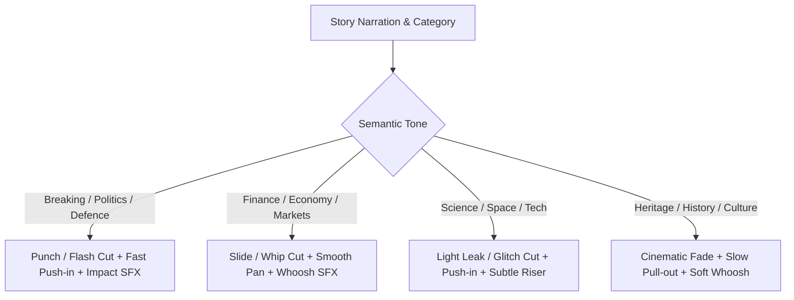

# Video Creative Direction & Visual Style Guide

## Overview
This document defines the unified creative identity for **BHARAT KI SOCH** YouTube Shorts. It establishes brand color palettes, semantic VFX grading, motion graphics layouts, and typography to maintain broadcast-grade production quality across daily runs.

---

## 1. Channel Creative Identity

| Element | Specification | Rationale |
| :--- | :--- | :--- |
| **Channel Name** | BHARAT KI SOCH (भारत की सोच) | Authoritative Indian news & knowledge brand. |
| **Aspect Ratio** | 9:16 Vertical ($1080 \times 1920$) | Native format for YouTube Shorts & Reels. |
| **Target Frame Rate** | 30 FPS constant | Smooth motion graphics rendering. |
| **Primary Color** | `#E50914` (Broadcast Crimson) | Urgent breaking news & hook lower-thirds. |
| **Secondary Color** | `#0B0F1A` (Deep Obsidian / Navy) | Contrast backing for cards, vignettes & overlays. |
| **Highlight Color** | `#FFD60A` (Golden Yellow) | Active karaoke caption highlighting & badges. |
| **Primary Font** | Mukta (ExtraBold / Bold / Medium) | Clean, legible Devanagari font with open counters. |

---

## 2. Harmonization of Creative Systems

### The Conflict (Previous Implementation)
Previously, two distinct creative engines competed:
1. `CreativeDirectorAgent` chose static rotating themes (e.g. `saffron`, `deep_blue`).
2. `EditorDirector` randomly rolled a multi-armed bandit recipe with alternative palettes and grades, overriding the Creative Director's choices.

### The Unified Solution (`EditorDirector.unify_creative_plan`)
All creative decisions now flow through a single hierarchy:
1. `CreativeDirectorAgent` establishes channel branding and foundational palette.
2. `VFXAgent` assigns tone-aware transition effects and camera motions based on the story category.
3. `MotionGraphicsAgent` prepares lower-third overlays, badges, and story progress counters.
4. `EditorDirector` harmonizes these inputs into a single `MasterEditingTimeline` without palette conflicts.

---

## 3. Semantic VFX & Transition Mapping

Transition effects are assigned contextually based on the story's emotional tone and topic:



### Color Grading Presets
- `broadcast_crisp`: Contrast 1.12, Saturation 1.20, Brightness 0.02, Unsharp filter. High clarity for TV bulletin news.
- `vivid_news`: High dynamic punch for outdoor breaking events and rallies.
- `warm_film`: Gentle warm color balance for historical, cultural, and spiritual topics.

---

## 4. Motion Graphics & Lower-Third Layouts

All overlays are generated at $1080 \times 1920$ with Devanagari RAQM font rendering:

```
+------------------------------------------+ (Y: 0)
| [Channel Watermark: BHARAT KI SOCH]      | (Y: 140)
|                                          |
|                                          |
|               MAIN VISUAL                |
|       (High-Res Photograph / Clip)       |
|                                          |
|                                          |
| [Category Badge: राष्ट्रीय] [Story 05/22] | (Y: 1380)
| +--------------------------------------+ |
| | HEADLINE LOWER-THIRD                 | | (Y: 1440 - 1580)
| | सुप्रीम कोर्ट ने चुनावी बॉन्ड पर सुनाया... | |
| +--------------------------------------+ |
| [KARAOKE CAPTIONS (Mukta ExtraBold)]     | (Y: 1610 - 1690)
| [SCROLLING BREAKING NEWS TICKER]         | (Y: 1726 - 1776)
+------------------------------------------+ (Y: 1920)
```

- **Top Safe Zone (0–220px)**: Clear of text to prevent obstruction by YouTube Shorts UI icons.
- **Bottom Safe Zone (1780–1920px)**: Reserved for Shorts player description and audio attribution.
- **Action Area (300–1700px)**: Center-weighted framing for maximum visual impact.
