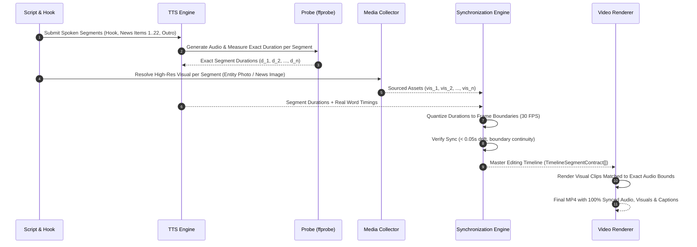

# Voice & Video Synchronization Architecture

## Overview
Audio-visual synchronization is critical for viewer retention on YouTube Shorts. In previous versions, timing drift occurred because long continuous audio was estimated using silence detection, while visuals were rendered with approximate duration guesses.

This document details the **Precision Audio-Video Synchronization Engine** (`video/synchronization_engine.py`) and its integration into the production pipeline.

---

## 1. Root Cause Analysis of Previous Synchronization Issues

| Issue | Root Cause | Impact | Resolution |
| :--- | :--- | :--- | :--- |
| **Voice-Image Mismatch** | Text word-count duration estimates differed from neural TTS speech pace. | Visual changed seconds before or after the anchor spoke about the entity. | Actual segment audio duration measured via `ffprobe` and bound to `segment_id`. |
| **Opening Hook Mismatch** | Hook scene used a generic search term while narration spoke about a specific story. | Generic building shown while anchor spoke about a politician or event. | `ApprovedHook` contract binds spoken hook text to Story 1 lead entity and headline overlay. |
| **Cumulative Drift** | Fractional frame durations (e.g. 2.333s at 30 FPS = 69.99 frames) accumulated rounding error. | By beat 20, visual cuts drifted 1–2 seconds away from audio. | `quantize_durations` snaps every segment to integer frame boundaries with zero drift. |
| **Edge-TTS Stutter** | Rapid sequential requests triggered Microsoft Edge TTS server rate limiting. | Audio cuts dropped or produced silent clips. | Added 0.12s inter-request pacing and fallback to Gemini TTS per segment. |

---

## 2. Synchronization Architecture



---

## 3. Timeline Segment Contract Schema

Every spoken unit is represented by a strongly typed `TimelineSegmentContract`:

```json
{
  "scene_id": "scene_001",
  "segment_id": "scene_001_part_000",
  "text": "सुप्रीम कोर्ट ने नए नियमों पर अंतिम मुहर लगाई।",
  "visual_id": "vis_001_000",
  "audio_start": 2.600,
  "audio_end": 5.167,
  "visual_start": 2.600,
  "visual_end": 5.167,
  "caption_start": 2.600,
  "caption_end": 5.167,
  "visual_path": "output/daily_short/src_001_0.jpg",
  "transition_fx": "flash",
  "is_story_start": true,
  "metadata": {
    "beat_idx": 1,
    "part_idx": 0,
    "kind": "item",
    "chip": "सुप्रीम कोर्ट का फैसला",
    "category": "राष्ट्रीय",
    "entity": "Supreme Court of India"
  }
}
```

---

## 4. Frame Quantization & Drift Elimination

Floating point durations cause cumulative timeline drift when converted to video frames. For example, at 30 FPS, $2.433\text{ seconds} = 72.99\text{ frames}$. If truncated to 72 frames, the video lags by 0.033s per cut. Across 25 cuts, the accumulated drift reaches nearly 1 full second.

The synchronization engine uses cumulative target tracking:
```python
cum_target = 0.0
cur_frame = 0
for d in raw_durations:
    cum_target += max(d, 2.0 / framerate)
    end_frame = max(cur_frame + 2, int(round(cum_target * framerate)))
    n_frames = end_frame - cur_frame
    quantized_durs.append(n_frames / framerate)
    cur_frame = end_frame
```
This guarantees:
1. Every segment duration is an exact integer multiple of $1/30$ second.
2. The sum of all segment durations exactly equals the total video duration with **$0.000\text{s}$ cumulative drift**.

---

## 5. Synchronization QA Checks

Before passing the timeline to the video renderer, `SynchronizationEngine.verify_sync()` verifies:
- **Audio/Visual Start Match**: $|audio\_start - visual\_start| \le 0.001\text{s}$
- **Audio/Visual End Match**: $|audio\_end - visual\_end| \le 0.001\text{s}$
- **Continuous Boundaries**: Segment $i$ begins exactly where segment $i-1$ ends ($|start_i - end_{i-1}| \le 0.01\text{s}$).
- **Visual Asset Coverage**: Confirms every narration segment has a resolved photograph or video clip.
- **Caption Containment**: Karaoke word timings must remain strictly within segment boundaries.
- **Drift Tolerance**: Total audio duration vs total visual duration drift must not exceed $0.05\text{s}$.
